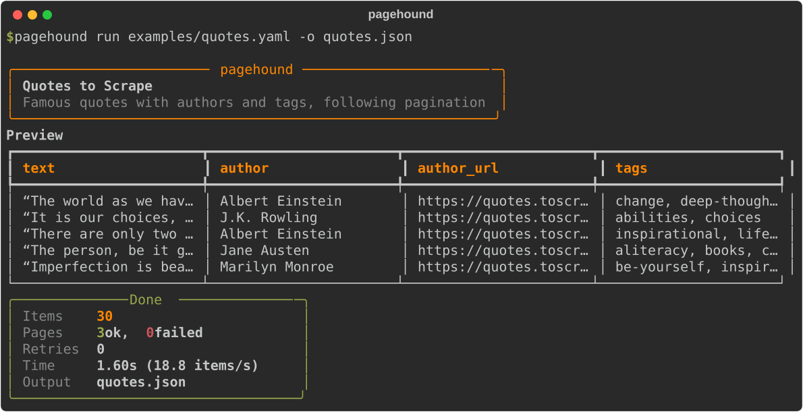
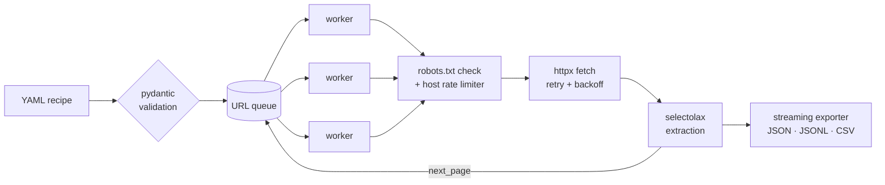

<div align="center">

# 🐕 pagehound

**Sniff out structured data from the web: async, polite and declarative.**

[](https://github.com/nvmchris/pagehound/actions/workflows/ci.yml)


[](LICENSE)



</div>

---

pagehound turns a short **YAML recipe** into a scraper that runs concurrently. You describe *what* you
want with CSS selectors. pagehound handles fetching, pagination, retries, rate limiting and
robots.txt, then streams the results to JSON, JSON Lines or CSV.

```yaml
# examples/quotes.yaml
name: Quotes to Scrape
start_urls: [https://quotes.toscrape.com/]
item: div.quote
fields:
  text: span.text
  author: small.author
  author_url:
    selector: a[href*="/author/"]::attr(href)
    transforms: [url]
  tags: { selector: a.tag, many: true }
next_page: li.next > a
```

```bash
pagehound run examples/quotes.yaml -o quotes.csv
```

## Features

- ⚡ **Async engine.** An `httpx` + `asyncio` worker pool with configurable concurrency.
- 🤝 **Polite by default.** Per-host rate limiting, robots.txt (RFC 9309) and an honest User-Agent.
- 🔁 **Resilient.** Retries with exponential backoff and jitter on 429, 5xx and network errors.
  Client errors (4xx) fail fast.
- 🧾 **Declarative recipes.** CSS selectors, `::attr()` shorthand, regex capture, value transforms,
  defaults and multi-value fields, all validated by pydantic with clear error messages.
- 📤 **Streaming export.** Items go to JSON, JSONL or CSV as they arrive, so memory use stays flat.
- 🎨 **Pleasant CLI.** Live progress, a preview table and a run summary, built with Typer and Rich.
- ✅ **Well tested.** 50+ tests and over 90% coverage, with mypy `--strict` and ruff. CI runs on
  Python 3.11 to 3.14.

## Installation

```bash
git clone https://github.com/nvmchris/pagehound.git
cd pagehound
python -m venv .venv && source .venv/bin/activate
pip install -e .
```

## Usage

### `run`: execute a recipe

```bash
pagehound run examples/books.yaml -o books.json        # format inferred from extension
pagehound run examples/books.yaml -o - | jq .price     # JSON Lines to stdout
pagehound run recipe.yaml --max-pages 3 --max-items 50 --concurrency 8 --delay 1
```

### `fetch`: explore a page before writing a recipe

```bash
pagehound fetch https://quotes.toscrape.com -s "small.author"
pagehound fetch https://books.toscrape.com -s "h3 a::attr(href)" --json
```

### `validate`: check a recipe

```bash
pagehound validate examples/books.yaml
```

### As a library

```python
import asyncio
from pagehound import Crawler, Recipe

recipe = Recipe.from_yaml("examples/quotes.yaml")


async def main() -> None:
    async with Crawler(recipe) as crawler:
        async for item in crawler.stream():
            print(item["author"], "-", item["text"][:60])
    print(crawler.stats)


asyncio.run(main())
```

## Recipe reference

| Key          | Description                                                                    |
| ------------ | ------------------------------------------------------------------------------ |
| `name`       | Display name of the job.                                                       |
| `start_urls` | One or more `http(s)` URLs to start crawling from.                             |
| `item`       | CSS selector for each item container. Leave it out to treat the whole page as one item. |
| `fields`     | A map of field name to a selector string or a field spec (see below).          |
| `next_page`  | CSS selector of the "next" link. pagehound follows it up to `max_pages`.       |
| `settings`   | Crawl settings (see below).                                                    |

**Field spec**

| Key          | Default | Description                                                              |
| ------------ | ------- | ------------------------------------------------------------------------ |
| `selector`   | —       | CSS selector, relative to the item. Supports `::text` and `::attr(name)`. |
| `attr`       | text    | Attribute to read instead of the text content.                           |
| `many`       | `false` | Return a list of all matches.                                            |
| `pattern`    | —       | Regex to apply. Keeps capture group 1, or the whole match.               |
| `transforms` | `[]`    | Any of `strip`, `lower`, `upper`, `int`, `float`, `number`, `url`.       |
| `default`    | `null`  | Value to use when nothing matches.                                       |

**Settings**

| Key              | Default | Description                                         |
| ---------------- | ------- | --------------------------------------------------- |
| `concurrency`    | `4`     | Number of parallel workers.                         |
| `delay`          | `0.5`   | Minimum seconds between requests to the same host.  |
| `timeout`        | `15`    | Request timeout in seconds.                         |
| `retries`        | `3`     | Retries for transient failures.                     |
| `backoff`        | `0.5`   | Base seconds for exponential backoff.               |
| `max_pages`      | `10`    | Maximum pagination depth per start URL.             |
| `max_items`      | —       | Stop after this many items.                         |
| `respect_robots` | `true`  | Obey robots.txt.                                    |
| `user_agent`     | `pagehound/0.1 (+repo url)` | User-Agent header.              |
| `headers`        | `{}`    | Extra request headers.                              |

## How it works



## Development

```bash
pip install -e ".[dev]"
pytest --cov=pagehound      # tests + coverage
ruff check . && ruff format --check .
mypy                        # strict type checking
python scripts/render_demo.py  # regenerate docs/demo.svg
```

## Responsible scraping

pagehound respects robots.txt and rate limits by default, and it is meant to stay that way. Scrape
only data you are allowed to collect, follow each site's terms of service, and keep request rates
low. The bundled examples target [toscrape.com](https://toscrape.com), a sandbox built for
practising web scraping.

## License

[MIT](LICENSE) © nvmchris
